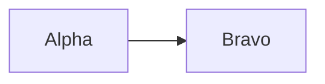
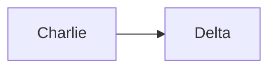

# Reload

reload.spec.mjs rewrites this file while a diagram is expanded, and puts it back after
each test. It's generated from ORIGINAL in that spec: edit it there, or the next run
puts this copy back.

