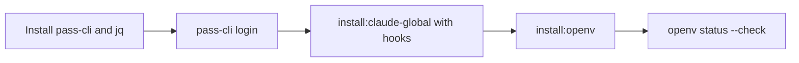
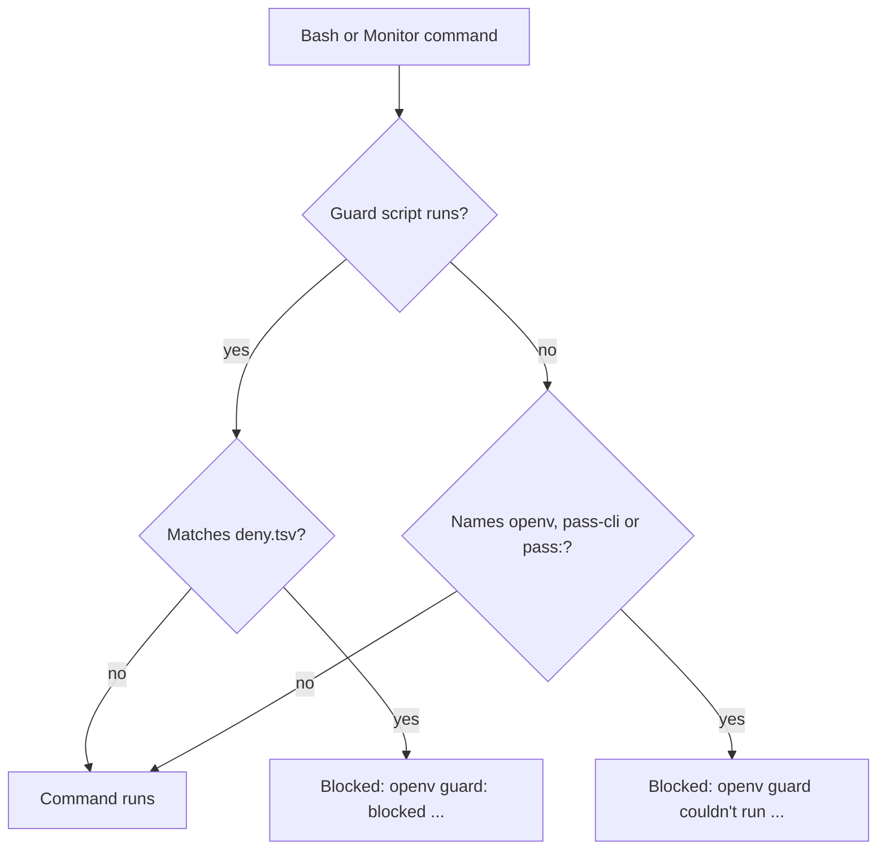

# openv playbook

How to set openv up and use it day to day: install it, add a profile, run a command with secrets, and get unstuck when the guard blocks something. [SKILL.md](SKILL.md) is the reference; this page links to it rather than repeating it.

The one rule behind all of it: secrets reach a command only through `openv run`, never through the session. See [The rule this skill exists for](SKILL.md#the-rule-this-skill-exists-for).

## 1. First-time setup



1. Install the tools from [Requirements](SKILL.md#requirements), then log in, in your own terminal:

   ```bash
   brew install protonpass/tap/pass-cli jq
   pass-cli login
   ```

2. From the toolkit's main checkout, install the skill and its command guard. The guard is what stops an agent from printing a value:

   ```bash
   mise run install:claude-global -- --with-hooks openv
   ```

   If you use the `openv` plugin from the marketplace instead, skip this step: the plugin installs the same guard. Don't do both.

3. Put `openv` on your PATH, so you can type `openv` in any terminal:

   ```bash
   mise run install:openv
   ```

   If `~/.local/bin/openv` already links to something else, this leaves it alone and says so. Add `-- --force` only when you're sure that link isn't a tool you want to keep. See [Install onto PATH](SKILL.md#install-onto-path).

4. Check that everything is in place:

   ```bash
   openv status --check
   ```

   It lists your profiles and vault allowlist, checks dependencies and the Proton Pass login, and says whether the PATH link points at this script. Start a new Claude Code session afterwards: running sessions don't pick up a new hook.

## 2. Add a profile

A profile is a dotenv file of variable names and `pass://` references. It holds no secret values, so it's safe to show. The layout and format are in [Where profiles live](SKILL.md#where-profiles-live).

1. Allow the vaults openv may read from, one name per line:

   ```bash
   mkdir -p ~/.config/openv
   $EDITOR ~/.config/openv/vaults
   ```

2. Create the profile: `~/.config/openv/global/<env>.env` to use it from anywhere, or `~/.config/openv/<project>/<env>.env` for one repo and all its worktrees, where `<project>` is the main checkout's directory name.

   ```dotenv
   OPENROUTER_API_KEY=pass://<share-id>/<item-id>/API Key
   LOG_LEVEL=debug
   ```

   Use share and item IDs rather than names, and no `export ` prefix. Look the IDs up in your own terminal, not in an agent session. `openv items` (plan step S4) will list them without values.

3. Check it parsed the way you meant:

   ```bash
   openv status
   ```

   References print in full, because they say where a secret lives, not what it is. Literals print as `(literal)`. Ignored lines and shell-sensitive variables (`PATH`, `LD_*` and the rest) are flagged.

**Is the project name unique?** Profiles are keyed by the directory name only, so two checkouts both called `api` share secrets. That's the one thing worth checking before you add a project profile for a repo you didn't write.

## 3. Run a command with secrets

```bash
openv run <env> -- <cmd>...
```

For example, `openv run dev -- pnpm test`. The values go to `<cmd>` only, and anything matching a secret on stdout or stderr shows as `<concealed by Proton Pass>`. The exit code is `<cmd>`'s. This is the form to use in an agent session, and the form to ask an agent to use. Masking is a string match, so a command that encodes a value or writes it to a file gets past it. See [Run a command with secrets](SKILL.md#run-a-command-with-secrets).

For your own terminal there's `eval "$(openv export <env>)"`, which refuses to run under an agent. Read [Load secrets into your own terminal](SKILL.md#load-secrets-into-your-own-terminal) before using it: every program started from that shell inherits the values, including an agent you start later.

## 4. When the guard blocks a command



**`openv guard: blocked ...`** The command would have printed a value (`openv export`, `pass-cli item view`, `--no-masking`, and the rest of `hooks/deny.tsv`). This is the guard working. Rewrite the command as `openv run <env> -- <cmd>`, as the message says. Don't work around it.

**`openv guard couldn't run (exit N) ...`** The hook can't start its script, usually because the checkout moved or the skill was uninstalled while its hook stayed behind. Only commands naming openv, pass-cli or pass: are blocked, so everything else still works. To fix it, from the toolkit's main checkout:

```bash
mise run install:claude-global -- --with-hooks openv    # re-link the skill, keep the guard
mise run uninstall:claude-global openv                  # or remove the skill and its hook
```

Then start a new session. If `settings.json` can't be edited (invalid JSON, say), uninstall says so and leaves both the link and the hook in place, so the guard keeps working until you fix the file.

**`openv guard: jq isn't installed ...`** The guard needs `jq` to look at commands naming openv or pass-cli, so it blocks them all until `brew install jq`. A similar message about `deny.tsv` or `guard.jq` means the skill's files are incomplete: re-run the install.

**`pass-cli` isn't logged in.** `openv status --check` says so. Run `pass-cli login` in your own terminal, never through an agent.
