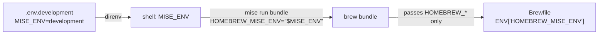

# Brewfile and environment variables

A `Brewfile` is Ruby, so `ENV['X']` looks like it reads your shell. It doesn't. Homebrew
cleans the environment before it evaluates the file, and **only variables whose names
start with `HOMEBREW_` get through.** Every other `ENV['X']` is `nil` inside a
`Brewfile`, so a gate written against one is silently always false.

This repo learned that the hard way: `cask 'antigravity-cli' if ENV['RAILS_ENV'] ==
'development'` never installed anything, even with `RAILS_ENV=development` exported
([LAR-353](https://linear.app/larcity-and-affiliates/issue/LAR-353)).

## How this repo gates dev-only casks



- `mise.toml` → `[tasks.bundle]` runs `HOMEBREW_MISE_ENV="${MISE_ENV:-}" brew bundle`.
- `Brewfile` gates on `ENV['HOMEBREW_MISE_ENV'] == 'development'`.
- A bare `brew bundle`, run without the mise task, skips the dev-only casks. That's the
  safe default.

## Adding a gated entry

1. Gate on a `HOMEBREW_`-prefixed variable, never the bare name.
2. Have the `mise` task that runs `brew bundle` pass the value in under that name.
3. Prove it with the check below before trusting it.

Pick a name Homebrew doesn't already use (`HOMEBREW_MISE_ENV` is ours). Homebrew's own
settings live in the same namespace (`HOMEBREW_NO_AUTO_UPDATE`, …), so a clash would
change Homebrew's behaviour, not just your gate.

## Checking a gate

`brew bundle list` evaluates the `Brewfile` without installing anything:

```bash
MISE_ENV=development mise run bundle list --casks   # gated casks listed
env -u MISE_ENV mise run bundle list --casks        # gated casks absent
```

If a gate seems not to fire, probe which variables Homebrew can see with a throwaway
file:

```bash
cat > /tmp/Brewfile.probe <<'EOF'
cask "always-listed"
cask "plain-gated" if ENV["MY_VAR"] == "1"
cask "hb-gated" if ENV["HOMEBREW_MY_VAR"] == "1"
EOF
MY_VAR=1 HOMEBREW_MY_VAR=1 brew bundle list --casks --file /tmp/Brewfile.probe
# always-listed
# hb-gated        <- plain-gated is missing: MY_VAR never reached the Brewfile
```

Verified 2026-11-19 on macOS with the Homebrew installed on this machine.
